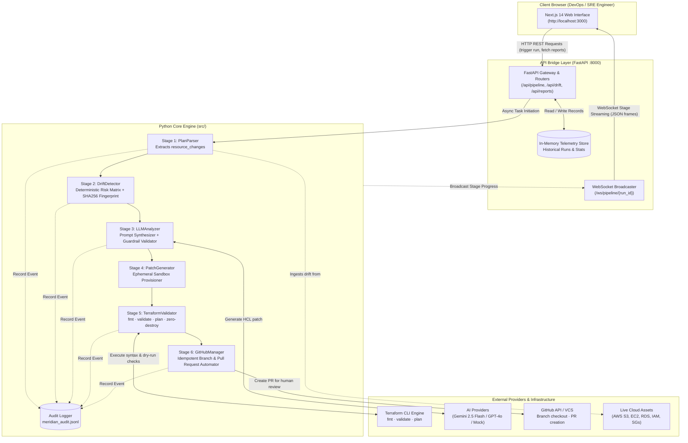
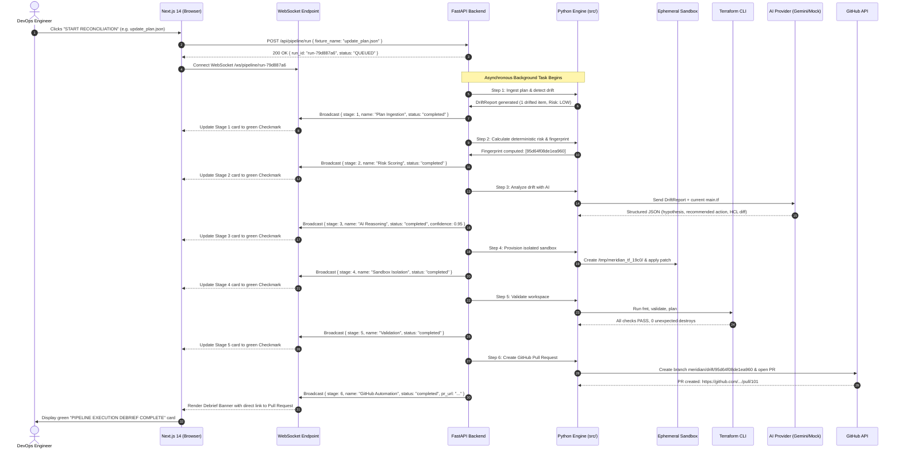
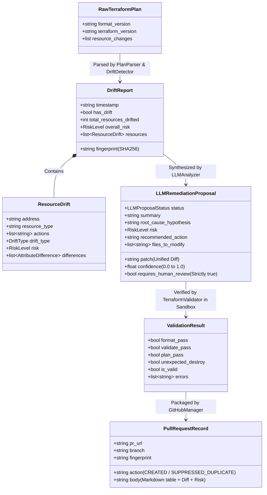
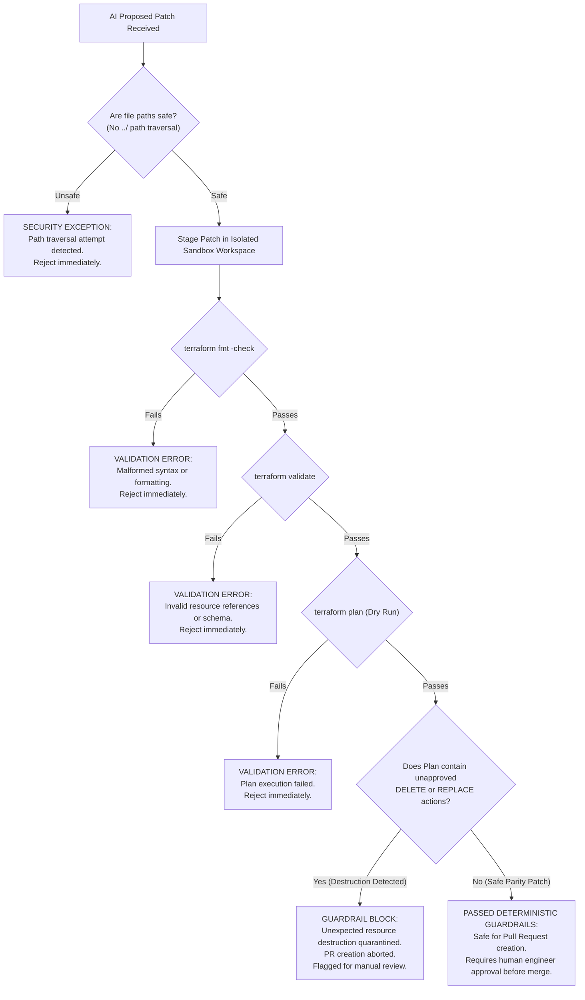

# IaC Sentinal — Complete Project Architecture & Working (Diagrammatic Guide)

> **Design Principle:** *"The LLM proposes. Terraform validates. GitHub reviews. A human approves."*  
> This document explains the complete end-to-end working of IaC Sentinal through structured diagrams and clear step-by-step descriptions.

---

## 1. High-Level System Architecture Diagram

This diagram shows how all three tiers (Frontend, API, and Core Engine) interact with external cloud services, LLM providers, and GitHub.

---

## 2. The 6-Stage Deterministic Remediation Loop

The core operating cycle follows a strict 6-stage progressive disclosure pipeline. At every stage, deterministic guardrails prevent AI hallucinations from reaching production.

```mermaid
flowchart TD
    Start(["Input: Terraform Plan JSON<br/>(terraform show -json)"]) --> S1

    subgraph Stage1 ["Stage 1: Ingestion & Normalization"]
        S1["PlanParser.parse_plan()"]
        S1 --> S1_Check{"Has Resource Changes?"}
        S1_Check -- No --> EndNoDrift["Status: NO_DRIFT<br/>Infrastructure synchronized. Stop."]
        S1_Check -- Yes --> S2
    end

    subgraph Stage2 ["Stage 2: Risk Scoring & Idempotency"]
        S2["DriftDetector.detect_drift()"]
        S2 --> S2_Fingerprint["Compute SHA256 Fingerprint<br/>Hash of address + actions + diffs"]
        S2_Fingerprint --> S2_Matrix["Evaluate Risk Level:<br/>• Delete / Replace -> CRITICAL<br/>• IAM / SG / RDS -> HIGH<br/>• Config attribute -> MEDIUM<br/>• Tags / Metadata -> LOW"]
        S2_Matrix --> S3
    end

    subgraph Stage3 ["Stage 3: AI Reasoning & Patch Synthesis"]
        S3["LLMAnalyzer.analyze_drift()<br/>(Gemini / OpenAI / Mock)"]
        S3 --> S3_Prompt["Inject DriftReport + Active main.tf into Prompt"]
        S3_Prompt --> S3_Output["LLM Outputs Strict JSON Schema:<br/>summary, hypothesis, recommendation, patch, confidence"]
        S3_Output --> S4
    end

    subgraph Stage4 ["Stage 4: Ephemeral Sandbox Isolation"]
        S4["PatchGenerator.create_isolated_workspace()"]
        S4 --> S4_Clone["Copy HCL files to temporary directory<br/>e.g. /tmp/meridian_tf_XXXX/"]
        S4_Clone --> S4_Apply["Stage AI Candidate Patch in sandbox<br/>(Path-traversal protection strictly enforced)"]
        S4_Apply --> S5
    end

    subgraph Stage5 ["Stage 5: Deterministic Validation & Guardrails"]
        S5["TerraformValidator.validate_workspace()"]
        S5 --> S5_Fmt["1. terraform fmt -check"]
        S5_Fmt --> S5_Validate["2. terraform validate"]
        S5_Validate --> S5_Plan["3. terraform plan (dry run)"]
        S5_Plan --> S5_Guardrail{"Unexpected Resource Destruction Detected?"}
        S5_Guardrail -- Yes --> Block["GUARDRAIL TRIGGERED:<br/>Quarantine patch. Abort PR creation.<br/>Status: FAILED / BLOCKED"]
        S5_Guardrail -- No --> Pass["All Deterministic Checks PASS"]
        Pass --> S6
    end

    subgraph Stage6 ["Stage 6: GitHub Automation & Human Gate"]
        S6["GitHubManager.create_or_update_pr()"]
        S6 --> S6_DupCheck{"Does PR exist for Fingerprint?"}
        S6_DupCheck -- Yes --> Suppress["SUPPRESSED_DUPLICATE<br/>Idempotent. Re-use existing PR."]
        S6_DupCheck -- No --> CreatePR["Create Git Branch: meridian/drift/{fingerprint}<br/>Commit staged HCL patch<br/>Open Pull Request on GitHub"]
        CreatePR --> HumanApproval{"Human DevOps Engineer Review"}
        HumanApproval -- Rejected --> Close["PR Closed without apply"]
        HumanApproval -- Approved & Merged --> Apply["Terraform Apply to Production"]
    end
```

---

## 3. End-to-End Sequence Diagram (User Action to PR)

This sequence diagram illustrates what happens second-by-second when a user clicks **"START RECONCILIATION"** on the web frontend.

---

## 4. Data Transformation & Model Lifecycle

How data transforms at every phase of the pipeline, from raw JSON to human-approved Pull Request:

---

## 5. Security & Guardrail Decision Tree

This diagram illustrates how IaC Sentinal protects cloud infrastructure against unexpected resource destruction or hallucinated code changes:

---

## 6. Summary of Architectural Guarantees

1. **Zero Hallucinated Destructions:** The LLM cannot delete production resources without failing Stage 5 deterministic guardrails.
2. **Deterministic Idempotency:** The SHA256 fingerprint guarantees that running the pipeline 100 times on the same drift produces only 1 Pull Request instead of spamming 100 duplicate PRs.
3. **No Direct Production Writes:** Neither the LLM nor the pipeline applies changes directly to the live cloud. A human DevOps engineer must review the diff on GitHub and merge the PR.
4. **Real-Time Telemetry:** Engineers do not need to poll terminals; WebSocket streams reflect live sandbox progress, validation results, and links in real time.
