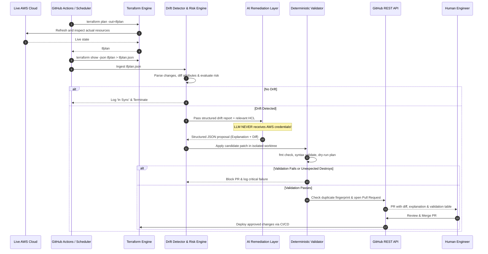

# MERIDIAN Architecture & System Design

## 1. Executive Summary

**MERIDIAN** is an AI-assisted Infrastructure-as-Code (IaC) drift detection and human-approved remediation system. It closes the feedback loop between live cloud infrastructure and version-controlled Terraform configurations while preserving strict human governance.

### The Core Principle
> **The LLM proposes. Terraform validates. GitHub reviews. A human approves.**  
> *MERIDIAN never silently modifies cloud infrastructure.*

---

## 2. Source-of-Truth Invariant

MERIDIAN explicitly adheres to the **GitOps Operating Model**:
- **Git / Terraform Code** = Authoritative Desired State
- **AWS Cloud** = Live Actual State
- **Drift** = Divergence between live actual state and repository desired state

When emergency manual modifications occur in the cloud console, MERIDIAN identifies the discrepancy, explains the root cause using an LLM, generates a minimal corrective HCL patch, deterministically validates it, and opens a GitHub Pull Request for human engineer review.

---

## 3. End-to-End Pipeline Data Flow

---

## 4. Key Subsystems

### 4.1 Plan Parsing & Deterministic Classification (`src/plan_parser.py`, `src/drift_detector.py`)
- Reads normalized JSON output from `terraform show -json`.
- Extracts before-and-after attribute differences across nested dicts.
- Categorizes actions: `ATTRIBUTE_UPDATE`, `RESOURCE_CREATE`, `RESOURCE_DELETE`, `RESOURCE_REPLACEMENT`.
- Applies a deterministic risk matrix (`LOW`, `MEDIUM`, `HIGH`, `CRITICAL`).

### 4.2 AI Reasoning & Structured Patch Synthesis (`src/llm_analyzer.py`)
- Provides prompt templates enforcing schema conformance and refusal to generate autonomous cloud apply operations.
- Outputs structured JSON parsed with Pydantic models.
- Provides fallback to `NEEDS_HUMAN_REVIEW` on ambiguous inputs.

### 4.3 Deterministic Validator & Isolated Sandbox (`src/patch_generator.py`, `src/validator.py`)
- Creates isolated temporary worktrees (`meridian_tf_*`) to prevent repository corruption.
- Applies candidate unified diffs or targeted HCL snippets with path traversal prevention.
- Validates syntax (`terraform validate`), formatting (`terraform fmt`), and checks that zero unexpected destroys or resource replacements occur.

### 4.4 GitHub Automation & Duplicate Prevention (`src/github_manager.py`)
- Computes SHA256 fingerprints based on sorted resource addresses, actions, and attribute deltas.
- Queries existing open Pull Requests to suppress duplicate PR creation on recurring cron jobs.
- Formats pull requests with structured markdown tables, explanations, and risk badges.
